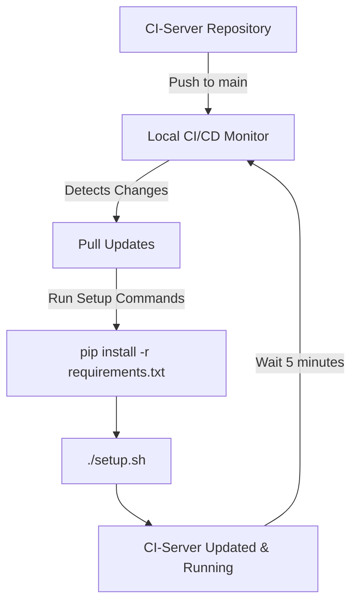
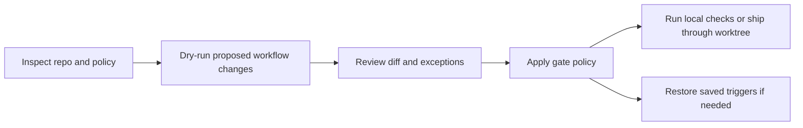

<h1 align="center">Local CI/CD Tooling for CI-Server</h1>

<p align="center"><strong>Local CI/CD tooling for Companion Intelligence repositories.</strong></p>

<p align="center"><a href="#quick-start">Get started</a> · <a href="#license">License</a></p>
[CloudFlare ZeroTrust Proxy Tutorial](https://docs.google.com/document/d/1zsFws3DiKwXNGd5hF0prV1OFkR6H7oNLQubNlucqETo/edit?tab=t.0)

---

## `ci-local` — move CI off billed runners

`ci-local` does two things: it gates GitHub Actions workflows down to manual
(`workflow_dispatch`) so they stop consuming billed minutes, and it runs the
equivalent lint/test/build steps on local hardware instead.

Sized against the July 2026 usage report: **$563.63/month net, of which
$401.03 is workflows this tool gates.**

### Commands

Every command is a dry run until you pass `--apply`.

```bash
# What would change, and what it saves. Point it at a usage report CSV
# exported from GitHub billing.
./ci-local audit --usage ~/Downloads/usageReport.csv

# Rewrite workflows to manual-only (dry run, then apply)
./ci-local gate
./ci-local gate --apply

# Undo it — restores the original triggers exactly
./ci-local restore --apply

# What the local equivalent of each repo's CI is
./ci-local plan --runnable-only

# Run those checks here
./ci-local run --repo CI-Server
./ci-local run --only test --jobs 6 --report /tmp/ci.json

# Run them automatically before every push (dry run, then apply)
./ci-local hooks install
./ci-local hooks install --apply

# Cap artifact retention — storage is billed wherever the job ran, so
# gating does nothing for it
./ci-local retention --days 7
./ci-local retention --days 7 --apply

# Open a PR per repo, gated on a clean worktree off each default branch
./ci-local ship --usage ~/Downloads/usageReport.csv
./ci-local ship --apply
```

### Drift watch

Gating is a snapshot, not a policy. Two things erode it:

- **New workflows are born ungated.** Every new marketplace app ships a
  `build-<app>.yml` with `on: push`. CI-Marketplace was fully gated and billing
  again within a day.
- **Feature branches keep the old triggers.** `push` events evaluate the
  workflow file *at the pushed commit*, so a branch created before the gating
  merge still fires the ungated workflows until it rebases. This one cannot be
  fixed from the default branch — it decays as branches land.

`verify` reads the **remote default branch**, not the local clone, because that
is what GitHub evaluates triggers from:

```bash
./ci-local verify --usage ~/Downloads/usageReport.csv   # what is live, and what it costs
./ci-local verify --save-baseline                       # record expected state
./ci-local verify --check-drift                         # exit 1 if anything got worse
./ci-local watch install --hour 9                       # run that check daily
./ci-local watch status
./ci-local watch uninstall
```

Drift is one-directional: gating *more* than the baseline is never reported.
Only regressions and newly-added ungated workflows fire.

### Three axes, decided separately

Spend is three independent questions, and every wrong number this tool has
produced came from answering one of them with another's evidence:

1. **Is anything automatic live?** — the triggers on the default branch.
   `gated` explains why the answer is no; it does not decide it.
2. **Would a run cost money?** — `local_ci/billing.py`, from the *restored*
   triggers and `runs-on`, so it survives the switch being off.
3. **Has it run lately?** — `local_ci/activity.py`, from run history
   (`ci-local verify --activity`). `unknown` is a real answer and never
   collapses into "dormant".

The policy `keep` list is **not** a fourth axis. It records a decision we made
about a workflow and changes nothing about what that workflow costs.

The baseline therefore records four sets:

- **`live_billing`** — putting minutes on the invoice today, kept workflows
  included. This is the bill.
- **`restore_cost`** — gated, and would bill again if restored. Disjoint from
  `live_billing` by construction.
- **`billable_if_restored`** — the union of the two: everything that costs
  money whenever it is not switched off.
- **`billing`** — the *policy-violation* set: live billing **minus** the keep
  list. Despite the name it is not the bill. It exists because drift detection
  compares it against a recorded baseline, and it must stay comparable.

`billing: []` therefore means neither "this repo is free" nor "nothing is
billing" — a repo whose only automatic workflow is a kept deploy has an empty
`billing` and a real monthly cost. Price restores against `restore_cost` and
budgets against `live_billing`.

Cost is weighted by runner OS, not by workflow count — Linux 1x, Windows 2x,
macOS 10x — and minutes are free on self-hosted runners and on public repos
using standard runners.

An idle live-billing workflow is still live-billing: it bills the moment
someone pushes. Activity ranks retirement candidates; it never reclassifies
spend.

The watch is a launchd agent (macOS) or systemd user timer (Linux), not a
scheduled GitHub Action — a job that polices Actions spend should not itself
burn billed minutes, and a workflow living in one repo cannot see the other
thirty.

### Why `ship` uses worktrees

The workspace clones are shared — dirty, on feature branches, with other agents
working in them. `ship` never commits from a clone. It creates a throwaway
worktree off `origin/<default branch>`, gates there, pushes that, and leaves the
clone exactly as found.

Default branches are resolved per repo, never assumed: CI-Hub, CI-Marketplace
and CI-Portal default to `dev`; CI-Browser-Extension, CI-Hermes, CI-OpenClaw and
CI-Tools-Cache-Mounts to `master`. Anything hard-coding `main` targets the wrong
base or fails outright.

### How gating works

The original trigger block is preserved as a comment directly above the
replacement, so the change is legible in review and `restore` needs no sidecar
state:

```yaml
# >>> ci-local:gated original triggers below, restore with `ci-local restore`
# on:
#   push:
#     branches: [main]
#   pull_request:
# <<< ci-local:gated
on:
  workflow_dispatch:
```

Only the `on:` block is touched — the rest of the file stays byte-identical, so
diffs stay reviewable across dozens of repos. `workflow_dispatch` inputs and
`workflow_call` are carried across, so manual runs keep their form and reusable
workflows keep working for their callers.

> **Gating only takes effect once the change reaches the branch the trigger
> fires on.** A gated workflow sitting in a feature branch still runs on
> `pull_request`, because GitHub reads that trigger from the base branch.

### Policy

`ci-local.toml` holds the exceptions. Default stance is "gate it".

| Section | Purpose |
|---|---|
| `workflows.keep` | Globs left on their automatic triggers — deploy-on-merge and tag-triggered release paths |
| `workflows.force_gate` | Gated even if `keep` matches — scheduled builds, publish workflows that also fire on every PR |
| `repos.aliases` | Clone directory → GitHub repo name, for repos renamed upstream (`CI-Applet` → `CI-Capture`) |
| `checks.<repo>` | `workdir`, `commands`, or `skip` for layouts the detector can't read off disk |

### Local check detection

Detection is evidence-based — a check is only emitted when something on disk
proves it exists. Package manager comes from the lockfile (which beats a stale
`packageManager` field). Node, Rust, Flutter, Go and Python are recognised;
anything else reports "not detected" rather than guessing.

For node repos the install step runs when `node_modules` is missing **or** when
the lockfile is newer than the installed tree. A tree left over from before a
dependency bump keeps serving the superseded package — the top-level copy stays
whatever was hoisted there at install time — so the checks run against versions
the lockfile doesn't describe, and nothing in the output says so. Every install
command is lockfile-frozen (`npm ci`, `--frozen-lockfile`, `--immutable`), so
reinstalling on a false positive costs time and nothing else.

### The pre-push hook checks the tree being pushed

A repo's hooks live in the git dir that all its worktrees share, so the same
`pre-push` file runs for a push from the main clone and for one from
`.claude/worktrees/<name>`. The hook passes its own working-tree root as
`--path`, so each push is gated on the tree that is actually being pushed, not on
whatever the main clone has checked out. `--repo` still names the
`[checks.<repo>]` entry, and without it `--path` falls back to the main clone's
directory name, not the worktree's.

```bash
./ci-local run --path ~/devel/ci/CI-Capture/.claude/worktrees/x   # what the hook runs
./ci-local plan --path .                                          # what it would run here
```

Checks also run without git's location variables. A push from a worktree
exports `GIT_DIR` to the hook. Any test that builds a scratch repo (`git init`
in a tmp dir, then `git config user.email …`) would inherit it and write into
the real repo's shared `.git/config`.

Hooks installed before this change still check the main clone until
`ci-local hooks install --apply` is re-run. Without `--apply` it lists, per repo,
whether the hook would be installed, updated or skipped, and writes nothing;
with it, it rewrites `.git/hooks/pre-push` in every repo it matches, so preview
first or scope it with `--repo`.

### Tests

```bash
python3 -m pytest -q
```

---

## Overview

This repository also provides local CI/CD monitoring tooling for the **[CI-Server](https://github.com/companionintelligence/CI-Server)** repository. It includes a Python daemon that automatically monitors the CI-Server repository for changes, pulls updates when detected, and runs configured setup commands.

### Key Features

- 🔄 **Automatic Monitoring**: Checks CI-Server repository every 5 minutes for updates
- 🚀 **Auto-Deployment**: Pulls changes and runs setup commands automatically  
- 🔧 **Flexible Deployment**: Supports both systemd service and manual execution
- 📊 **Comprehensive Logging**: Detailed logging with timestamps
- ✅ **Setup Verification**: Built-in scripts to verify proper configuration

---

## Prerequisites

- **Python 3.6+** 
- **Git** (with access to companionintelligence repositories)
- **Linux/Unix** environment (tested on Ubuntu/Debian)
- **Internet connection** for repository synchronization

---

## Quick Start

### 1. Initial Setup

First, clone and set up the CI-Server repository:

```bash
# Create development directory
mkdir -p ~/devel
cd ~/devel

# Clone the CI-Server repository
git clone https://github.com/companionintelligence/CI-Server
```

### 2. Verify Setup

```bash
# Make scripts executable
chmod +x *.sh *.py

# Verify the CI-Server setup
./verify_setup.sh
```

### 3. Test the Monitoring Daemon

```bash
# Run the complete test suite
./run_test.sh
```

### 4. Deploy the Monitor

Choose your preferred deployment method:

```bash
# Deploy as systemd service OR manual runner
python3 deploy_ci_monitor.py
```

---

## Repository Structure

| File | Purpose |
|------|---------|
| `ci-server_local_cicd.py` | Main monitoring daemon |
| `verify_setup.sh` | Verifies CI-Server repository setup |
| `test_ci_server_daemon.py` | Interactive test runner for the daemon |
| `run_test.sh` | Complete test orchestration script |
| `deploy_ci_monitor.py` | Deployment script (systemd/manual) |
| `git_update_daemon.py` | Generic git monitoring daemon template |

---

## Detailed Usage

### Configuration

The main daemon (`ci-server_local_cicd.py`) is pre-configured for CI-Server monitoring:

```python
# Default Configuration
REPO_DIR = "~/devel/CI-Server"        # CI-Server repository location
GIT_REMOTE = "origin"                 # Git remote name
GIT_BRANCH = "main"                   # Branch to monitor  
CHECK_INTERVAL = 5 * 60               # Check every 5 minutes

# Setup commands run after each update
SETUP_COMMANDS = [
    "pip install -r requirements.txt",
    "./setup.sh"
]
```

### Manual Execution

To run the monitoring daemon manually:

```bash
# Run in foreground (Ctrl+C to stop)
python3 ci-server_local_cicd.py

# Run in background
python3 ci-server_local_cicd.py &

# Check if running
ps aux | grep ci-server_local_cicd
```

### Systemd Service Deployment

For automatic startup and management:

```bash
# Deploy as systemd service
python3 deploy_ci_monitor.py
# Choose option 1 when prompted

# Service management commands
sudo systemctl status ci-server-monitor     # Check status
sudo systemctl stop ci-server-monitor       # Stop service  
sudo systemctl restart ci-server-monitor    # Restart service
sudo journalctl -u ci-server-monitor -f     # View logs
```

### Manual Runner Script

For on-demand execution:

```bash
# Deploy manual runner
python3 deploy_ci_monitor.py
# Choose option 2 when prompted

# Execute the runner
./run_ci_monitor.sh
```

---

## Step-by-Step Workflow

### Complete Setup Process

1. **Environment Preparation**
   ```bash
   # Ensure prerequisites
   python3 --version  # Should be 3.6+
   git --version      # Should be present
   ```

2. **Repository Setup**
   ```bash
   mkdir -p ~/devel
   cd ~/devel
   git clone https://github.com/companionintelligence/CI-Server
   ```

3. **CI-Local-CICD Setup**
   ```bash
   cd /path/to/CI-Local-CICD
   chmod +x *.sh *.py
   ./verify_setup.sh
   ```

4. **Testing**
   ```bash
   ./run_test.sh
   # Follow prompts to test the daemon
   ```

5. **Production Deployment**
   ```bash
   python3 deploy_ci_monitor.py
   # Choose systemd (option 1) for production
   ```

### Verification Steps

The `verify_setup.sh` script checks:

- ✅ CI-Server repository exists at `~/devel/CI-Server`
- ✅ Repository is a valid Git repository
- ✅ Repository is up to date with `origin/main`
- 📊 Shows current branch and commit information

---

## Troubleshooting

### Common Issues

**Repository Not Found**
```bash
❌ CI-Server repository not found at ~/devel/CI-Server
```
*Solution:* Clone the CI-Server repository to the correct location:
```bash
mkdir -p ~/devel
cd ~/devel  
git clone https://github.com/companionintelligence/CI-Server
```

**Permission Issues**
```bash
❌ Permission denied executing scripts
```
*Solution:* Make scripts executable:
```bash
chmod +x *.sh *.py
```

**Git Authentication**
```bash
❌ Failed to fetch from remote repository
```
*Solution:* Ensure Git credentials are configured:
```bash
git config --global user.name "Your Name"
git config --global user.email "your.email@example.com"
# Set up SSH keys or personal access tokens as needed
```

**Python Dependencies**
```bash
❌ ModuleNotFoundError or import errors
```
*Solution:* Ensure Python 3.6+ is installed:
```bash
python3 --version
sudo apt update && sudo apt install python3 python3-pip  # Ubuntu/Debian
```

### Monitoring Issues

**Daemon Not Detecting Changes**
- Check if the repository path is correct
- Verify network connectivity
- Check Git credentials and permissions
- Review daemon logs for error messages

**Setup Commands Failing**
- Verify `requirements.txt` exists in CI-Server
- Check if `setup.sh` is executable
- Review command output in logs

### Log Files

- **Manual execution**: Output to console
- **systemd service**: `sudo journalctl -u ci-server-monitor -f`
- **Manual runner**: `ci-monitor.log` in the script directory

---

## Integration with CI-Server

This tool is specifically designed to work with the [CI-Server](https://github.com/companionintelligence/CI-Server) repository:

1. **Monitors**: `~/devel/CI-Server` repository
2. **Triggers**: Automatic updates when CI-Server changes are pushed
3. **Executes**: CI-Server setup commands after each update
4. **Maintains**: Continuous synchronization with the main branch

### Workflow Integration



---

<!-- companion-hub-readme-deep-review -->

## Workflow policy at a glance

| Policy | Effect |
|---|---|
| Default gate | Converts eligible automatic CI workflows to manual triggers after review |
| `keep` | Leaves deployment and release workflows automatic |
| `force_gate` | Explicitly gates a selected workflow, including CI-Hub nightly when configured |
| `exclude` | Skips repositories that should not be rewritten |
| Restore | Reinstates the exact saved workflow triggers |



Run the dry-run first and inspect the per-repository diff before applying changes. `keep`, `force_gate`, and `exclude` are policy controls, not interchangeable shortcuts; see the configuration and drift-watch sections for their exact behavior.

## Support

For issues related to:
- **CI-Local-CICD tool**: Create issues in this repository
- **CI-Server integration**: Check the [CI-Server repository](https://github.com/companionintelligence/CI-Server)
- **Setup and configuration**: Review the troubleshooting section above

---

## License

COPYRIGHT COMPANION INTELLIGENCE - LIFESCOPE INC  
PRIVATE AND CONFIDENTIAL - DO NOT DISTRIBUTE
