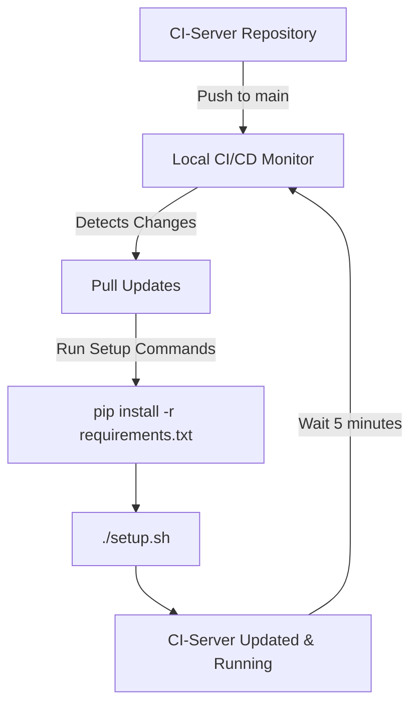

# Local CI/CD Tooling for CI-Server

## COPYRIGHT COMPANION INTELLIGENCE - LIFESCOPE INC

## DO NOT DISTRIBUTE

## PRIVATE AND CONFIDENTIAL

[CloudFlare ZeroTrust Proxy Tutorial](https://docs.google.com/document/d/1zsFws3DiKwXNGd5hF0prV1OFkR6H7oNLQubNlucqETo/edit?tab=t.0)

---

## Overview

This repository provides local CI/CD monitoring tooling for the **[CI-Server](https://github.com/companionintelligence/CI-Server)** repository. It includes a Python daemon that automatically monitors the CI-Server repository for changes, pulls updates when detected, and runs configured setup commands.

### Key Features

- 🔄 **Automatic Monitoring**: Checks CI-Server repository every 5 minutes for updates
- 🚀 **Auto-Deployment**: Pulls changes and runs setup commands automatically  
- 🔧 **Flexible Deployment**: Supports both systemd service and manual execution
- 📊 **Comprehensive Logging**: Detailed logging with timestamps
- ✅ **Setup Verification**: Built-in scripts to verify proper configuration

---

## Prerequisites

- **Python 3.6+** 
- **Git** (with access to companionintelligence repositories)
- **Linux/Unix** environment (tested on Ubuntu/Debian)
- **Internet connection** for repository synchronization

---

## Quick Start

### 1. Initial Setup

First, clone and set up the CI-Server repository:

```bash
# Create development directory
mkdir -p ~/devel
cd ~/devel

# Clone the CI-Server repository
git clone https://github.com/companionintelligence/CI-Server
```

### 2. Verify Setup

```bash
# Make scripts executable
chmod +x *.sh *.py

# Verify the CI-Server setup
./verify_setup.sh
```

### 3. Test the Monitoring Daemon

```bash
# Run the complete test suite
./run_test.sh
```

### 4. Deploy the Monitor

Choose your preferred deployment method:

```bash
# Deploy as systemd service OR manual runner
python3 deploy_ci_monitor.py
```

---

## Repository Structure

| File | Purpose |
|------|---------|
| `ci-server_local_cicd.py` | Main monitoring daemon |
| `verify_setup.sh` | Verifies CI-Server repository setup |
| `test_ci_server_daemon.py` | Interactive test runner for the daemon |
| `run_test.sh` | Complete test orchestration script |
| `deploy_ci_monitor.py` | Deployment script (systemd/manual) |
| `git_update_daemon.py` | Generic git monitoring daemon template |

---

## Detailed Usage

### Configuration

The main daemon (`ci-server_local_cicd.py`) is pre-configured for CI-Server monitoring:

```python
# Default Configuration
REPO_DIR = "~/devel/CI-Server"        # CI-Server repository location
GIT_REMOTE = "origin"                 # Git remote name
GIT_BRANCH = "main"                   # Branch to monitor  
CHECK_INTERVAL = 5 * 60               # Check every 5 minutes

# Setup commands run after each update
SETUP_COMMANDS = [
    "pip install -r requirements.txt",
    "./setup.sh"
]
```

### Manual Execution

To run the monitoring daemon manually:

```bash
# Run in foreground (Ctrl+C to stop)
python3 ci-server_local_cicd.py

# Run in background
python3 ci-server_local_cicd.py &

# Check if running
ps aux | grep ci-server_local_cicd
```

### Systemd Service Deployment

For automatic startup and management:

```bash
# Deploy as systemd service
python3 deploy_ci_monitor.py
# Choose option 1 when prompted

# Service management commands
sudo systemctl status ci-server-monitor     # Check status
sudo systemctl stop ci-server-monitor       # Stop service  
sudo systemctl restart ci-server-monitor    # Restart service
sudo journalctl -u ci-server-monitor -f     # View logs
```

### Manual Runner Script

For on-demand execution:

```bash
# Deploy manual runner
python3 deploy_ci_monitor.py
# Choose option 2 when prompted

# Execute the runner
./run_ci_monitor.sh
```

---

## Step-by-Step Workflow

### Complete Setup Process

1. **Environment Preparation**
   ```bash
   # Ensure prerequisites
   python3 --version  # Should be 3.6+
   git --version      # Should be present
   ```

2. **Repository Setup**
   ```bash
   mkdir -p ~/devel
   cd ~/devel
   git clone https://github.com/companionintelligence/CI-Server
   ```

3. **CI-Local-CICD Setup**
   ```bash
   cd /path/to/CI-Local-CICD
   chmod +x *.sh *.py
   ./verify_setup.sh
   ```

4. **Testing**
   ```bash
   ./run_test.sh
   # Follow prompts to test the daemon
   ```

5. **Production Deployment**
   ```bash
   python3 deploy_ci_monitor.py
   # Choose systemd (option 1) for production
   ```

### Verification Steps

The `verify_setup.sh` script checks:

- ✅ CI-Server repository exists at `~/devel/CI-Server`
- ✅ Repository is a valid Git repository
- ✅ Repository is up to date with `origin/main`
- 📊 Shows current branch and commit information

---

## Troubleshooting

### Common Issues

**Repository Not Found**
```bash
❌ CI-Server repository not found at ~/devel/CI-Server
```
*Solution:* Clone the CI-Server repository to the correct location:
```bash
mkdir -p ~/devel
cd ~/devel  
git clone https://github.com/companionintelligence/CI-Server
```

**Permission Issues**
```bash
❌ Permission denied executing scripts
```
*Solution:* Make scripts executable:
```bash
chmod +x *.sh *.py
```

**Git Authentication**
```bash
❌ Failed to fetch from remote repository
```
*Solution:* Ensure Git credentials are configured:
```bash
git config --global user.name "Your Name"
git config --global user.email "your.email@example.com"
# Set up SSH keys or personal access tokens as needed
```

**Python Dependencies**
```bash
❌ ModuleNotFoundError or import errors
```
*Solution:* Ensure Python 3.6+ is installed:
```bash
python3 --version
sudo apt update && sudo apt install python3 python3-pip  # Ubuntu/Debian
```

### Monitoring Issues

**Daemon Not Detecting Changes**
- Check if the repository path is correct
- Verify network connectivity
- Check Git credentials and permissions
- Review daemon logs for error messages

**Setup Commands Failing**
- Verify `requirements.txt` exists in CI-Server
- Check if `setup.sh` is executable
- Review command output in logs

### Log Files

- **Manual execution**: Output to console
- **systemd service**: `sudo journalctl -u ci-server-monitor -f`
- **Manual runner**: `ci-monitor.log` in the script directory

---

## Integration with CI-Server

This tool is specifically designed to work with the [CI-Server](https://github.com/companionintelligence/CI-Server) repository:

1. **Monitors**: `~/devel/CI-Server` repository
2. **Triggers**: Automatic updates when CI-Server changes are pushed
3. **Executes**: CI-Server setup commands after each update
4. **Maintains**: Continuous synchronization with the main branch

### Workflow Integration



---

## Support

For issues related to:
- **CI-Local-CICD tool**: Create issues in this repository
- **CI-Server integration**: Check the [CI-Server repository](https://github.com/companionintelligence/CI-Server)
- **Setup and configuration**: Review the troubleshooting section above

---

## License

COPYRIGHT COMPANION INTELLIGENCE - LIFESCOPE INC  
PRIVATE AND CONFIDENTIAL - DO NOT DISTRIBUTE
